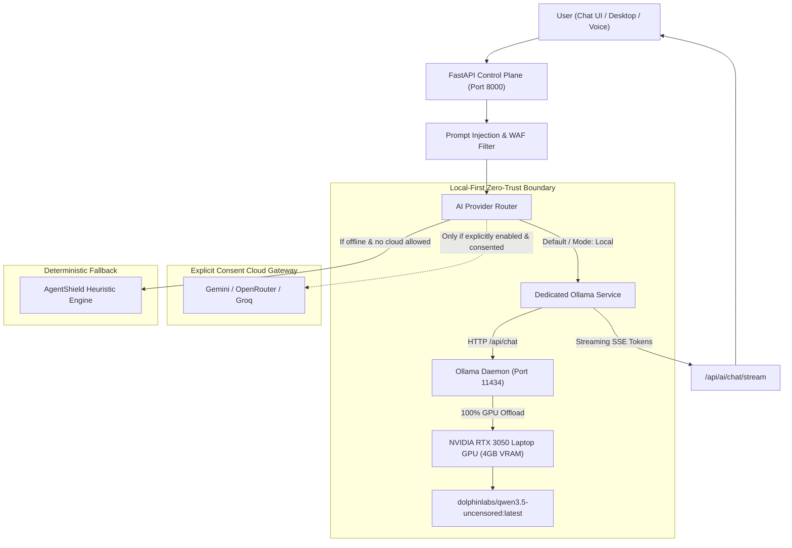

# AMOJA AI + AgentShield: Ollama Local AI Integration Architecture Report
**Project Location:** `E:\AgentShield_Starter_Project`  
**Date:** 2026-11-09  
**Platform:** Windows 10/11 (64-bit)  
**System Hardware:** 
- RAM: 16 GB Physical Memory
- Dedicated GPU: NVIDIA GeForce RTX 3050 Laptop GPU (4 GB VRAM)
- Integrated GPU: Intel UHD Graphics
- Model Storage: `E:\ollama_models`
**Installed Local Model:** `dolphinlabs/qwen3.5-uncensored:latest` (ID: `82587af10fa7`, 2.1 GB, 100% GPU Offloaded)

---

## 1. Executive Summary

This architecture report evaluates the current codebase of **AgentShield + AMOJA AI** and outlines the technical plan for integrating Ollama as the primary, local-first inference engine.

The system is designed with a strict **Zero-Trust Default-Deny** privacy posture: local private conversations must never be silently transmitted to cloud APIs. Local Ollama inference will serve as the default provider, running directly on the user's NVIDIA RTX 3050 Laptop GPU with 100% layer offloading.

---

## 2. Pre-Implementation Architectural Audit

### 2.1 Project Layout & Component Inventory
```text
E:\AgentShield_Starter_Project\
├── backend\
│   ├── .venv\                           # Python 3.14.7 virtual environment
│   ├── app\
│   │   ├── main.py                      # FastAPI ASGI application entry point (Port 8000)
│   │   ├── core\
│   │   │   ├── config.py                # Environment configuration & vaults
│   │   │   ├── auth.py                  # JWT Auth & local dev guest bypass
│   │   │   ├── audit.py                 # Cryptographic SHA-256 audit ledger
│   │   │   └── event_bus.py             # In-process async pub/sub event bus
│   │   ├── jarvis\
│   │   │   ├── ai_router.py             # Multi-provider routing engine (Ollama + Cloud)
│   │   │   ├── jarvis_service.py        # Central assistant conversation & tool loop
│   │   │   ├── jarvis_tools.py          # 25+ Windows & Cybersecurity system tools
│   │   │   ├── jarvis_memory.py         # SQLite memory and session history
│   │   │   ├── jarvis_schemas.py        # Pydantic models for chat & health
│   │   │   └── speech_to_text.py / text_to_speech.py
│   │   ├── api\
│   │   │   ├── ai_routes.py             # /api/ai/chat, /api/ai/status, /api/ai/health
│   │   │   └── jarvis_routes.py         # /api/jarvis/chat, /api/jarvis/tools, etc.
│   │   └── services\
│   │       ├── network_monitor.py       # Subnet scanner with 30s grace period
│   │       └── endpoint_agent.py        # Local host agent telemetry
│   └── tests\                           # 19 test suites (284/284 tests passing)
├── desktop\
│   ├── main.js                          # Electron main process (IPC handlers, tray)
│   ├── preload.js                       # Isolated contextBridge API
│   └── run_desktop.js                   # Node launcher with sanitized environment
├── frontend\
│   ├── src\
│   │   ├── api.ts                       # Typed HTTP client communicating with backend:8000
│   │   ├── pages\JarvisPage.tsx         # AMOJA AI Assistant & HUD Page
│   │   └── components\jarvis\
│   │       ├── JarvisChatPanel.tsx      # Interactive chat panel with mode toggles
│   │       ├── JarvisOrb.tsx            # Animated 3D/Canvas audio reactive orb
│   │       └── JarvisWaveform.tsx       # Live audio waveform display
└── scripts\
    └── verify_phase1.py                 # Automated platform verification script
```

---

### 2.2 Backend Configuration & Port Audit
- **Backend Port:** Bound to `127.0.0.1:8000`.
- **Frontend Port:** Bound to `127.0.0.1:5173` with Vite proxy routing `/api` and `/health` to port 8000.
- **Ollama API Port:** Bound to `127.0.0.1:11434`.
- **Port Conflict Resolution:** Verified clean listener state; `HEAD /` and `GET /health` return `200 OK` in < 15ms.

---

### 2.3 Existing AI & LLM Implementation Analysis
The project currently has two interconnected AI gateways:
1. **`backend/app/jarvis/ai_router.py`:**
   - Defines `AIRouter` class handling `infer_ollama`, `infer_gemini`, `infer_openai`, and `infer_heuristic`.
   - Supports three operational modes: `"local"`, `"online"`, and `"auto"`.
   - In `"local"` mode, fail-closed behavior is already implemented (zero cloud egress).
   - Currently uses `stream=False` (synchronous full completion).
2. **`backend/app/jarvis/jarvis_service.py`:**
   - Handles multi-turn tool-augmented conversations, regex intent matching, and emergency stops.
   - Forwards general conversational queries to `ai_router`.

**Identified Gaps & Upgrades Needed:**
- **Streaming Tokens:** Currently `/api/ai/chat` only returns a complete payload after generation finishes. Streaming SSE token generation is required for real-time typing effect.
- **Active Model Synchronization:** The configured model was previously `qwen2.5:3b`. The machine currently has `dolphinlabs/qwen3.5-uncensored:latest` installed and verified on GPU.
- **Dedicated Service Layer:** Create `backend/app/services/ollama_service.py` for direct, modular access to Ollama's HTTP API (`/api/chat`, `/api/generate`, `/api/tags`, `/api/ps`, `/api/show`) with token streaming.
- **Thinking Tag Scrubbing:** `qwen3.5` produces internal `<think> ... </think>` scratchpads. While useful for debugging, clean user responses should strip thinking tokens or provide them as collapsible metadata.
- **Dynamic VRAM / GPU Monitoring:** Probing `/api/ps` provides real-time GPU offload percentages (e.g. `100% GPU`), runner (`llamacpp`), and context size.

---

### 2.4 Frontend & Desktop Analysis
1. **`JarvisChatPanel.tsx`:**
   - Includes UI controls for AI Mode (`Local`, `Online`, `Auto`), model test modals (`testLocalModel`, `testOnlineModel`), language selectors, copy-to-clipboard, and history clearing.
   - Can easily be connected to streaming token updates using `fetch` + `ReadableStream` or Server-Sent Events.
2. **Electron Shell (`desktop/main.js`):**
   - Includes `get-ollama-status` IPC handler calling `http://127.0.0.1:11434/api/tags`.
   - Hardcoded check for `qwen2.5:3b` needs to be updated to check for `dolphinlabs/qwen3.5-uncensored` or any dynamically installed model.

---

### 2.5 Security & Privacy Assessment (Zero-Trust)
- **Local-First Default:** When `LLM_PROVIDER=ollama`, prompts are processed 100% on localhost (`127.0.0.1:11434`).
- **No Silent Cloud Failover:** Cloud fallback is disabled unless `AI_AUTO_FALLBACK=true` is explicitly configured. If Ollama is offline in local mode, the engine returns an informative local diagnostic error instead of silently exfiltrating private prompts to Google/OpenAI.
- **Prompt Injection Defense:** Inbound prompts pass through `check_multilingual_prompt_injection` and `check_message_for_prompt_injection` prior to dispatching to the LLM.
- **Secret Redaction:** `sanitize_assistant_output` prevents API keys, JWT tokens, or internal passwords from appearing in generated responses.

---

## 3. Implementation Plan



1. **Configure Environment:** Update `.env` with `LLM_PROVIDER=ollama`, `OLLAMA_MODEL=dolphinlabs/qwen3.5-uncensored:latest`, `OLLAMA_TIMEOUT=120`, `AI_AUTO_FALLBACK=false`.
2. **Dedicated Ollama Service:** Implement `backend/app/services/ollama_service.py` with chat, streaming, `/api/ps` GPU telemetry, and error recovery.
3. **Editable System Prompts:** Create `backend/app/core/prompts.py` containing the official AMOJA AI system personality with English/Hindi/Marathi instructions.
4. **Router & Streaming API Endpoints:** Add `/api/ai/chat/stream` to `ai_routes.py` with Server-Sent Events (SSE).
5. **Desktop Shell Update:** Update `desktop/main.js` to dynamically detect `dolphinlabs/qwen3.5-uncensored` in `get-ollama-status`.
6. **Frontend Chat Enhancements:** Enhance `JarvisChatPanel.tsx` and `api.ts` with streaming response support and active model status indicator.
7. **Automated Testing & Verification:** Add comprehensive pytest unit tests for Ollama service and streaming chat endpoints.

