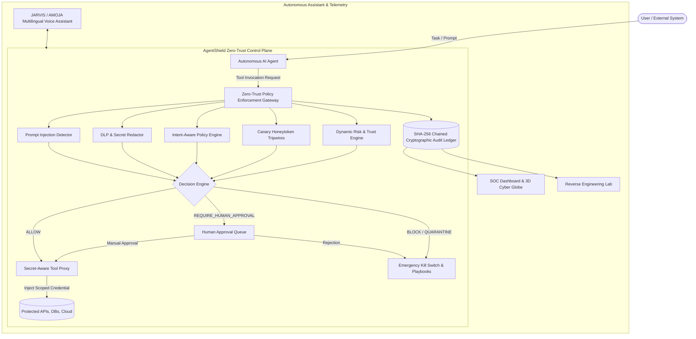

# AgentShield — Product Requirements Document (PRD)

**Document Version:** 1.0.0  
**Status:** Approved & Implemented  
**Date:** November 2026  
**Product:** AgentShield — AI Agent Security Platform  
**Tagline:** *"Who Controls the AI?"*  
**Classification:** Enterprise Security / Zero-Trust AI Control Plane  

---

## 1. Executive Summary

Autonomous AI agents possess unprecedented autonomy: they formulate plans, interact with external APIs, execute shell commands, access relational databases, delegate subtasks to peer agents, and process untrusted user and web inputs. However, traditional cybersecurity perimeters (firewalls, EDRs, API gateways) are blind to agentic intent, prompt injection payloads, tool permission creep, and autonomous decision drift.

**AgentShield** is a defense-grade, production-oriented **Zero-Trust Security Control Plane** specifically architected for autonomous AI agents and multi-agent meshes. It continuously monitors agent actions, intercepts tool calls at policy enforcement boundaries, redacts sensitive credentials and PII, isolates prompt injection attempts, manages emergency kill switches, provides automated forensic dossiers, and anchors all telemetry into an immutable SHA-256 chained audit ledger.

---

## 2. Problem Statement & Market Drivers

| Industry Challenge | Autonomous Agent Risk | AgentShield Solution |
| :--- | :--- | :--- |
| **Non-Deterministic Decisions** | Agents take unpredictable paths to reach goals, bypassing static rulebooks. | Intent-aware policy engine + Dynamic Risk & Continuous Trust scoring with Markovian transitions. |
| **Prompt Injection (OWASP LLM01)** | Malicious payloads inside user prompts or tool outputs hijack agent directives. | Multi-modal prompt injection heuristic engine, Unicode normalization, and adversarial mutation testing. |
| **Unbounded Tool Execution** | Agents invoke dangerous APIs (`DELETE`, `TRANSFER_FUNDS`, `DROP TABLE`). | Default-deny tool proxy gateway with fine-grained RBAC, parameter validators, and Human-in-the-Loop approvals. |
| **Data Exfiltration (OWASP LLM02)** | Sensitive customer PII or API tokens leak via egress webhooks or model completions. | Real-time Data Loss Prevention (DLP) engine with regex/entropy detectors and simulated secure enclaves. |
| **Privilege Drift in Multi-Agent Meshes** | Low-privilege agents delegate tasks to high-privilege agents to bypass policy. | Multi-agent delegation graph enforcement with 15% trust decay per hop and cross-agent correlation. |
| **Rogue / Shadow AI** | Developers or employees run uninstrumented local/cloud LLMs accessing corporate data. | Network & process telemetry discovery, socket sniffing, and 1-click onboarding workflows. |
| **Hostile Code & Binary Artifacts** | Agents download or execute malicious scripts, DLLs, or packed executables. | Zero-Trust Reverse Engineering Lab & REA (Reverse Engineer Anything) Forensics Suite. |

---

## 3. Product Vision & Principles

1. **Default-Deny Zero-Trust Posture:** No agent tool call or egress network request is permitted unless matched by an explicit, active policy rule.
2. **Severed Enforcement Boundary:** Agents never talk directly to external APIs or databases. All calls route through the Secret-Aware Tool Proxy where credentials are dynamically injected.
3. **Cryptographic Non-Repudiation:** Every policy decision, risk evaluation, tool call, and human approval is cryptographically chained into an append-only SHA-256 ledger.
4. **Local-First Privacy Architecture:** Fully functional offline or in air-gapped environments utilizing local AI models (Ollama Qwen2.5-3B) and local multilingual voice engines (Whisper STT + Piper TTS) with zero mandatory cloud telemetry egress.
5. **Strict Fact vs. Threat Separation:** Telemetry engines strictly distinguish verified empirical data (Observed Facts) from analytical risk models (Inferred Threats) and missing information (Unknowns).

---

## 4. User Personas & Target Audiences

| Persona | Role | Primary Use Cases |
| :--- | :--- | :--- |
| **Security Operations (SOC) Analyst** | Daily Triage & Monitoring | Uses Overview Dashboard, Live Activity Monitor, and 3D Cyber Globe to monitor agent fleet health, investigate prompt injection attempts, and triage high-risk incidents. |
| **CISO & AI Governance Officer** | Policy Compliance & Risk Management | Inspects Trust/Risk decay trends, exports cryptographic audit ledgers, configures GitOps Policy-as-Code, and satisfies regulatory AI compliance (EU AI Act, NIST AI RMF). |
| **Incident Responder & Forensic Analyst** | Post-Breach Forensics | Utilizes Reverse Engineering Lab, Timeline Reconstruction, and REA Subsystem to decompile payloads, inspect ASTs, and export sealed forensic dossiers. |
| **DevOps / AI Platform Engineer** | Infrastructure & Agent Integration | Enrolls agent identities, monitors shadow LLM processes, configures scoped credentials in the Secret Vault, and automates CI/CD deployments. |
| **Security Operator (JARVIS Voice User)** | Hands-Free Command Center | Uses voice directives in English, Hindi, Marathi, or Hinglish to query threat metrics, review approval queues, or trigger emergency quarantine. |

---

## 5. System Architecture & Component Model

---

## 6. Functional Requirements & Feature Matrix

AgentShield provides **43 comprehensive production capabilities**:

### 6.1 Identity, Policy & Governance
- **FR-01 (Agent Identity Management):** Register, configure, and manage agent identities with scoped models, baseline instructions, purpose descriptions, and operational versions.
- **FR-02 (Zero-Trust Agent Access):** Intercept all incoming agent actions at the gateway boundary prior to downstream dispatch.
- **FR-03 (Fine-Grained Permission Control):** RBAC and ABAC permission matrices governing tools (`READ`, `WRITE`, `EXECUTE`, `DELETE`, `EGRESS`).
- **FR-04 (Intent-Aware Policy Engine):** Validates consistency between declared agent purpose and actual runtime tool arguments.
- **FR-05 (Permission Drift Detection):** Detects runtime permission expansions beyond baseline authorizations and flags anomalous drift.
- **FR-06 (Policy-as-Code & GitOps):** Declarative YAML policy editing, schema validation, version tracking, and rollback capabilities.

### 6.2 Threat Detection, Egress & Redaction
- **FR-07 (Prompt Injection Detection):** 18+ heuristic signatures, Unicode canonicalization, Base64 unpacking, and multimodal payload analysis (OWASP LLM01).
- **FR-08 (Adversarial Prompt Mutation Testing):** Automated red-team fuzzing that mutates baseline prompts using leetspeak, homoglyphs, and delimiter injection to evaluate guardrail resilience.
- **FR-09 (Data Loss Prevention - DLP):** Automatic regex and Shannon entropy inspection redacting API keys, JWTs, AWS credentials, credit cards, and PII in payloads and agent egress.
- **FR-10 (Canary & Honeytoken Tripwires):** Deployment and monitoring of synthetic credentials (AWS keys, OpenAI tokens, database connection strings). Immediate quarantine upon unauthorized access.
- **FR-11 (Multi-Modal Attack Surface Scanner):** Evaluates multi-vector inputs combining system prompts, user queries, tool arguments, and indirect external outputs.

### 6.3 Risk, Trust & Behavioral Modeling
- **FR-12 (Dynamic Agent Risk Scoring):** Real-time composite risk scoring (0-100) calculated from prompt injection risk, tool risk weight, DLP triggers, and anomalous parameter patterns.
- **FR-13 (Continuous Trust Score & Decay):** Trust scoring that builds over validated interactions but decays mathematically on suspicious anomalies or multi-hop agent delegations.
- **FR-14 (Predictive Risk Forecasting):** Near-future risk projection using sliding window statistical models and uncertainty margins.
- **FR-15 (Behavioral Signature & Concept Drift):** Baselines tool invocation frequency, execution sequence Markov models, and flags anomalous deviation patterns.

### 6.4 Response, Containment & Quarantine
- **FR-16 (Human-in-the-Loop Approval Queue):** Holds high-risk or sensitive tool invocations in a cryptographically sealed queue requiring operator approval/rejection.
- **FR-17 (Automatic Kill Switch & Quarantine):** Instant suspension of rogue or compromised agents with zero-delay socket termination and revocation flags.
- **FR-18 (Explainable Kill Switch & Counterfactuals):** Provides transparent reasons for agent termination with "what-if" counterfactual thresholds.
- **FR-19 (Autonomous Security Response Playbooks):** Pre-configured automated runbooks executing graduated responses: Warn $\rightarrow$ Throttle $\rightarrow$ Revoke Token $\rightarrow$ Terminate Agent $\rightarrow$ Block IP.

### 6.5 Multi-Agent & Attack Surface Observability
- **FR-20 (Agent-to-Agent Security & Mesh):** Validates identity and authorization boundaries in multi-agent workflows.
- **FR-21 (Cross-Agent Delegation Graph):** Interactive visualization mapping inter-agent task handoffs with 15% trust decay per hop.
- **FR-22 (Cross-Agent Attack Correlation):** Identifies coordinated multi-agent attack campaigns attempting distributed privilege escalation.
- **FR-23 (Digital Twin & Sandbox Replay):** Replays historical agent action traces against updated or alternate policy configurations to evaluate impact.
- **FR-24 (Shadow AI Discovery):** Scans system processes and network sockets for unauthorized LLM API egress, rogue Ollama instances, or unmonitored agent runtimes.
- **FR-25 (Network Telemetry & Continuous Scanner):** Non-disruptive TCP connect scanner evaluating authorized CIDR ranges for unexpected open ports and banner changes.
- **FR-26 (3D Cyber Globe Telemetry):** WebGL/Three.js interactive globe rendering real-time geospatial threat traffic, agent nodes, and active incident arcs.

### 6.6 Cryptographic Audit & Non-Repudiation
- **FR-27 (SHA-256 Chained Cryptographic Audit Ledger):** Every event is cryptographically sealed to its prior entry:
  $$H_i = \text{SHA-256}(H_{i-1} \parallel \text{timestamp} \parallel \text{actor} \parallel \text{action} \parallel \text{resource} \parallel \text{details\_json})$$
- **FR-28 (One-Click Ledger Verification):** Automated endpoint traversing the entire blockchain-like database table to detect tampering, insertion, or retroactive alteration.

### 6.7 Reverse Engineering Lab & Binary Forensics
- **FR-29 (Zero-Trust Host Execution Protection):** Direct execution of untrusted binaries on the host OS is strictly disabled; dynamic analysis is replaced with static AST and PE/ELF inspection.
- **FR-30 (Cryptographic Hashing & Section Entropy):** Computes MD5, SHA-1, and SHA-256 with Shannon entropy analysis to detect packed sections (UPX, etc.).
- **FR-31 (PE / ELF Deep Header Parser):** Extracts architectures, subsystems, compilation timestamps, and dangerous imports mapped to MITRE ATT&CK techniques.
- **FR-32 (Source Code AST Static Analyzer):** Safe syntax tree inspection for Python (`ast` visitor), JavaScript, PowerShell, and Bash.
- **FR-33 (REA - Reverse Engineer Anything Subsystem):** Native integration with `morluto/rea` (v6.7.0) supporting SQLite schemas, Electron apps, .NET assemblies, AI models (GGUF/Safetensors), and Go binaries.
- **FR-34 (Tamper-Sealed Forensic Dossier Generator):** Generates downloadable, cryptographically signed JSON and printable investigation reports.

### 6.8 JARVIS / AMOJA Autonomous Multilingual Assistant
- **FR-35 (Cinematic SOC Voice Interface):** Electric-cyan glowing multi-ring orb, animated audio waveform visualizer, and HUD telemetry strip.
- **FR-36 (Multilingual Voice Recognition & Synthesis):** Full conversational support for English, Hindi (हिन्दी), Marathi (मराठी), and Hinglish with automatic language detection.
- **FR-37 (100% Local-First Privacy Mode):** Offline STT (`whisper_local` / faster-whisper) and offline TTS (`piper_indic_local` / acoustic harmonic synthesizer) with zero cloud egress.
- **FR-38 (Controlled Tool Invocation):** 17+ read-only and governed execution tools for SOC summaries, agent risk queries, incident triage, and forensic briefings.
- **FR-39 (Voice Human Confirmation Workflow):** High-impact actions (kill switch, agent revocation) require explicit verbal confirmation before execution.

---

## 7. Application Views & User Experience

The web user interface (React 18 + Vite + Tailwind/Custom CSS) provides **30 specialized console views**:

1. **Authentication & RBAC (`/login`):** JWT authentication with role badges (Admin, Analyst, Operator, Auditor).
2. **Main SOC Overview (`/`):** KPI telemetry, threat matrices, active agent count, and system status.
3. **AI Agent Inventory (`/agents`):** Agent catalog, baseline prompt inspectors, and permission editors.
4. **Agent Testing Lab (`/agent-lab`):** Interactive sandbox to dispatch prompts and test tool execution.
5. **Real-Time Activity Monitor (`/real-time`):** Live WebSocket event stream with latency tracking.
6. **Prompt Injection Scanner (`/prompt-injection`):** Live heuristic testing, payload analysis, and mutation fuzzer.
7. **Threat Alerts & Incidents (`/incidents`):** Incident triage dashboard with evidence inspector and containment actions.
8. **Human Approval Queue (`/approvals`):** Review pending sensitive tool invocations with payload diffs.
9. **Risk & Trust Analytics (`/risk-trust`):** Risk distribution charts, trust score degradation, and Markov graphs.
10. **Predictive Risk Forecast (`/predictive-risk`):** Time-series risk modeling with upper/lower bounds.
11. **Attack Graph Explorer (`/attack-graph`):** Interactive node-link graph mapping Prompts $\rightarrow$ Agents $\rightarrow$ Resources.
12. **Multi-Agent Delegation Mesh (`/delegation-graph`):** Cross-agent communication topology with trust decay visualizer.
13. **Shadow AI Discovery (`/shadow-ai`):** Process sniffer detecting uninstrumented LLM endpoints.
14. **Red-Team Simulation Lab (`/red-team`):** Pre-built attack scenarios (credential harvest, data dump, privilege escalation).
15. **Digital Twin Replay (`/digital-twin`):** Replays historical traces against modified policy sets.
16. **Secret-Aware Tool Proxy (`/tool-proxy`):** Catalog of allowed tool endpoints with credential mapping.
17. **Secret Manager Vault (`/secrets`):** Enclave-simulated vault with masked credential views.
18. **DLP & PII Inspector (`/dlp`):** Egress inspection rules and live redaction testing utility.
19. **Behavioral Drift Analysis (`/behavior-drift`):** Concept drift charts and tool call sequence frequency histograms.
20. **Canary Token Manager (`/canary-tokens`):** Synthetic credential generation, deployment, and tripwire logs.
21. **Policy-as-Code Studio (`/policy-code`):** GitOps YAML policy editor with real-time linting.
22. **Reverse Engineering Lab (`/reverse-engineering`):** Static binary inspector, AST analyzer, and REA panel.
23. **Forensic Report Generator (`/forensic-report`):** Sealed incident dossiers with SHA-256 verification stamps.
24. **Cryptographic Audit Ledger (`/audit-trail`):** Immutable event table with one-click chain integrity check.
25. **Cyber Globe 3D (`/globe`):** Three.js interactive 3D globe showing global threat origins and attack arcs.
26. **Network Surface Monitor (`/network`):** Authorized CIDR scanner, open port diffs, and subnet telemetry.
27. **Application Firewall (`/firewall`):** OWASP inspection rules, rate limiting, and blocked IP tables.
28. **Endpoint Security Agent (`/endpoint`):** Host agent daemon status, open sockets, and process inventory.
29. **JARVIS AI Assistant (`/jarvis` or `Ctrl+J`):** Futuristic voice-driven security assistant HUD.
30. **Settings & RBAC Management (`/settings`):** Global timeout configurations, log retention, and user management.

---

## 8. Non-Functional Requirements (NFRs)

### 8.1 Performance & Latency Budgets
- **Gateway Interception Overhead:** Policy evaluation + Prompt Injection check + DLP inspection must execute in $\le 50\text{ ms}$ for standard tool calls.
- **Local Voice Latency:** Piper Indic TTS synthesis must respond in $\le 40\text{ ms}$; Faster-Whisper local ASR latency $\le 300\text{ ms}$.
- **Audit Logging Overhead:** Asynchronous SHA-256 chaining must not block gateway responses ($< 5\text{ ms}$).

### 8.2 Security & Integrity
- **Default-Deny:** In the event of engine failure or unhandled exception, tool calls fail closed (BLOCK).
- **Zero Raw Credential Exposure:** Downstream tools receive vaulted credentials at the gateway proxy; agent LLMs never see genuine upstream secrets.
- **Tamper Evidence:** Any database alteration of audit entries breaks all downstream hashes and triggers an immediate verification alarm.

### 8.3 Reliability & Airgap Resilience
- **Offline Self-Sufficiency:** The control plane, rule engines, local AI router, and voice assistant must operate with zero internet connectivity.
- **Resilient Fallback:** If local Ollama or cloud LLMs are unavailable, the system automatically falls back to deterministic heuristic evaluation with zero downtime.

### 8.4 Storage & System Resource Optimization
- **Windows Drive Preservation:** All heavy model weights (GGUF/Ollama) are redirected to the secondary drive (`E:\ollama_models`), maintaining zero C: drive bloat.
- **Memory Footprint:** Complete control plane (backend + frontend) runs in $< 600\text{ MB}$ RAM; with local Qwen2.5-3B active, total RAM usage remains under $4.5\text{ GB}$ (leaving $> 11\text{ GB}$ free on 16GB workstations).

---

## 9. Technology Stack

| Layer | Component | Technologies |
| :--- | :--- | :--- |
| **Backend Core** | API Server & Engines | Python 3.14+, FastAPI, Pydantic v2, Uvicorn, asyncio, psutil |
| **Database & Cryptography** | Persistent Store & Hash Chains | SQLite3 (WAL mode), SHA-256 HMAC, bcrypt, JWT |
| **AI Gateway & Routing** | Multi-Provider Engine | Ollama (Local GGUF), Google Gemini API, Groq, OpenRouter |
| **Voice & Acoustic Processing** | STT / TTS Pipeline | Whisper Local (faster-whisper), Piper Indic ONNX, Web Speech API |
| **Frontend Client** | Single Page Application (SPA) | React 18, TypeScript, Vite, TailwindCSS, Lucide Icons |
| **Visualization & 3D** | Interactive Telemetry | Three.js, React-Globe.gl, Canvas 2D Waveforms, CSS HUD |
| **Binary Forensics** | Reverse Engineering Engine | REA (v6.7.0), Python `ast`, PE/ELF static parsers, YARA heuristics |
| **Host Endpoint Agent** | Background Telemetry Daemon | Python daemon, Windows Task Scheduler / systemd unit |

---

## 10. Verification & Quality Assurance

- **Test Suite:** Comprehensive test suite with 242 automated tests covering all security engines, permission boundaries, DLP, prompt injection, and cryptographic audit chains.
- **Execution:** `pytest -v` within the Python virtual environment.
- **Verification Directives:**
  - `GET /health` $\rightarrow$ Validates control plane initialization and Zero-Trust enforcement status.
  - `GET /api/audit/verify` $\rightarrow$ Traverses the complete cryptographic chain.
  - `GET /api/ai/health` $\rightarrow$ Reports local vs. cloud AI availability and storage telemetry.

---

## 11. Release & Deployment Model

1. **Local Development Mode:**
   - Backend: `uvicorn app.main:app --host 127.0.0.1 --port 8000 --reload`
   - Frontend: `npm run dev` (Vite proxying to port 8000)
2. **Containerized Deployment:**
   - Multi-stage `docker-compose.yml` spinning up FastAPI backend on port 8000 and Nginx-hosted Vite frontend on port 5173.
3. **Endpoint Deployment:**
   - Transparent PowerShell installer (`scripts/install_windows.ps1`) and shell script (`scripts/install_linux.sh`) with zero covert kernel drivers.

---

*AgentShield Control Plane Specification — "Who Controls the AI?"*

