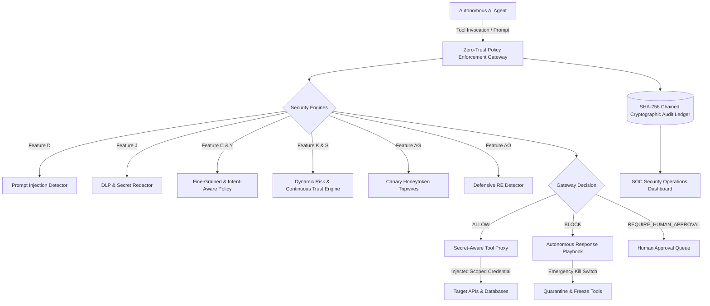

# AgentShield — AI Agent Security Platform

Tagline: **"Who Controls the AI?"**

AgentShield is a complete, production-oriented Zero-Trust Security Control Plane for autonomous AI agents. It continuously monitors AI agents, evaluates tool calls at the policy boundary, detects prompt injections, enforces fine-grained permissions, prevents sensitive data exfiltration (DLP), manages emergency kill switches, investigates incidents, and provides cryptographic audit trails and reverse engineering modules.

---

## Architecture Overview



---

## 41 Core, Advanced, Unique & Reverse Engineering Features

| # | Code | Feature | Implementation Module | Status |
|---|------|---------|-----------------------|--------|
| 1 | **A** | AI Agent Identity Management | `app/api/agents_routes.py` | **Complete** |
| 2 | **B** | Zero-Trust Agent Access | `app/engines/policy_engine.py` | **Complete** |
| 3 | **C** | Fine-Grained Permission Control | `app/engines/policy_engine.py` | **Complete** |
| 4 | **D** | Prompt Injection Detection | `app/engines/prompt_injection.py` | **Complete** |
| 5 | **E** | AI Agent Behavior Monitoring | `app/engines/behavior_monitor.py` | **Complete** |
| 6 | **F** | Tool-Call Monitoring | `app/engines/tool_proxy.py` | **Complete** |
| 7 | **G** | Human-in-the-Loop Approval | `app/api/approvals_routes.py` | **Complete** |
| 8 | **H** | Automatic Kill Switch | `app/engines/kill_switch.py` | **Complete** |
| 9 | **I** | Secret and Credential Protection | `app/core/config.py`, `app/engines/dlp.py` | **Complete** |
| 10 | **J** | Data Loss Prevention (DLP) | `app/engines/dlp.py` | **Complete** |
| 11 | **K** | Dynamic Agent Risk Score | `app/engines/risk_engine.py` | **Complete** |
| 12 | **L** | Complete Audit Trail (SHA-256) | `app/core/audit.py` | **Complete** |
| 13 | **M** | SOC-Style Security Dashboard | `frontend/src/pages/OverviewPage.tsx` | **Complete** |
| 14 | **N** | Explainable AI Security Analyst | `app/engines/explainable_analyst.py` | **Complete** |
| 15 | **O** | Agent Attack Graph Explorer | `frontend/src/pages/AttackGraphPage.tsx` | **Complete** |
| 16 | **P** | Agent-to-Agent Security | `app/engines/multi_agent.py` | **Complete** |
| 17 | **Q** | Shadow AI / Unknown Agent Detection | `app/engines/shadow_ai.py` | **Complete** |
| 18 | **R** | Permission Drift Detection | `app/engines/policy_engine.py` | **Complete** |
| 19 | **S** | Continuous Trust Score | `app/engines/risk_engine.py` | **Complete** |
| 20 | **T** | Attack Simulation / Red-Team Lab | `app/engines/simulation.py` | **Complete** |
| 21 | **U** | Autonomous Security Response | `app/engines/playbooks.py` | **Complete** |
| 22 | **V** | Predictive Risk Engine | `app/engines/risk_engine.py` | **Complete** |
| 23 | **W** | Cross-Agent Attack Correlation | `app/engines/multi_agent.py` | **Complete** |
| 24 | **X** | Digital Twin and Sandbox Replay | `app/engines/digital_twin.py` | **Complete** |
| 25 | **Y** | Intent-Aware Policy Engine | `app/engines/policy_engine.py` | **Complete** |
| 26 | **Z** | Cross-Agent Delegation Graph | `frontend/src/pages/DelegationGraphPage.tsx` | **Complete** |
| 27 | **AA**| Adversarial Prompt Mutation Testing | `app/engines/prompt_injection.py` | **Complete** |
| 28 | **AB**| Secret-Aware Tool Proxy | `app/engines/tool_proxy.py` | **Complete** |
| 29 | **AC**| Behavioral Signature & Concept Drift | `app/engines/behavior_monitor.py` | **Complete** |
| 30 | **AD**| Explainable Kill Switch & Counterfactuals | `app/engines/kill_switch.py` | **Complete** |
| 31 | **AE**| Network & Process Telemetry Discovery | `app/engines/shadow_ai.py` | **Complete** |
| 32 | **AF**| Next-Action Forecasting | `app/engines/risk_engine.py` | **Complete** |
| 33 | **AG**| Canary Tokens and Honey Tokens | `app/engines/canary.py` | **Complete** |
| 34 | **AH**| Policy-as-Code and GitOps | `app/engines/policy_engine.py`, `app/api/policy_routes.py` | **Complete** |
| 35 | **AI**| Multi-Modal Attack Surface Monitoring | `app/engines/prompt_injection.py` | **Complete** |
| 36 | **AJ**| Agent Behaviour Reverse Engineering | `app/engines/reverse_engineering.py` | **Complete** |
| 37 | **AK**| System Prompt & Instruction Analysis | `app/engines/reverse_engineering.py` | **Complete** |
| 38 | **AL**| Tool and API Call Reverse Engineering | `app/engines/reverse_engineering.py` | **Complete** |
| 39 | **AM**| Malicious Payload Reverse Engineering | `app/engines/reverse_engineering.py` | **Complete** |
| 40 | **AN**| Compromised Agent Forensics | `app/engines/reverse_engineering.py` | **Complete** |
| 41 | **AO**| Defensive Reverse Engineering Detection | `app/engines/reverse_engineering.py` | **Complete** |
| 42 | **AP**| JARVIS AI Autonomous Assistant & Voice Interface | `app/jarvis/`, `app/api/jarvis_routes.py`, `frontend/src/components/jarvis/` | **Complete** |

---

## 26 Application Views

1. **Login and Authentication**: JWT authentication with RBAC and credentials quick-fill.
2. **Main Security Dashboard**: SOC/SIEM telemetry overview, threat matrix, and incident summary.
3. **AI Agent Inventory & Detail**: Fine-grained permissions, baseline instructions, and controls.
4. **Permission & Policy Management**: Zero-Trust policies and rule priorities.
5. **Real-Time Activity Monitor**: Continuous streaming telemetry with latency tracking.
6. **Prompt Injection Analysis**: Multimodal heuristic scanner and adversarial mutation testing.
7. **Threat Alerts & Incidents**: Incident triage, evidence inspector, and status containment.
8. **Human Approval Queue**: Review sensitive actions, payload preview, approve/reject workflows.
9. **Risk and Trust Analytics**: Dynamic risk scores, trust score decay, and Markov transitions.
10. **Attack Graph Explorer**: Interactive graph mapping Prompts $\rightarrow$ Agents $\rightarrow$ Gateway $\rightarrow$ Resources.
11. **Multi-Agent Delegation Mesh**: Cross-agent delegation, trust boundaries, and hop decay.
12. **Shadow AI Discovery**: Rogue process inspection, unmonitored LLM beacons, and onboarding.
13. **Red-Team Simulation Laboratory**: Pre-built OWASP Top 10 attack scenarios and mitigation scorecards.
14. **Predictive Risk Analysis**: Near-future risk forecasting with uncertainty margins.
15. **Digital Twin & Sandbox Replay**: Configuration snapshot and alternative policy simulation.
16. **Tool Proxy Gateway**: Scoped credential injection, allowed destinations, and execution.
17. **Secret Manager & Enclave Vault**: Masked credential storage and egress redaction status.
18. **DLP Policy & Event Viewer**: PII/credential detection rules and live redaction tester.
19. **Behavioral Drift Analysis**: Concept drift, frequency anomalies, and sequence deviations.
20. **Canary / Honey Token Manager**: Deploy synthetic AWS, OpenAI, DB, and SSN tripwires.
21. **Policy-as-Code & GitOps**: Declarative YAML policy editor, validation, and release history.
22. **Reverse Engineering Lab**: Timeline reconstruction, system prompt diff, and payload analysis.
23. **Incident Forensic Dossiers**: Downloadable JSON and printable forensic report generator.
24. **Cryptographic Audit Logs**: SHA-256 chained immutable ledger with one-click verification.
25. **Settings & RBAC**: User accounts, roles (Admin, Analyst, Operator, Auditor), and settings.
26. **JARVIS AI Security Command Center**: Futuristic voice-enabled SOC assistant, animated orb, audio waveform visualizer, proactive threat briefings, approved tool execution, and human confirmation workflow. Toggle anytime with `Ctrl+J`.

---

## JARVIS AI Autonomous Assistant & Voice Interface

JARVIS is a cinematic, Zero-Trust autonomous AI cybersecurity assistant built natively into the AgentShield control plane.

### Key Capabilities:
- **Cinematic Futuristic HUD**: Electric-cyan glowing multi-ring orb, animated audio visualizer, real-time SOC telemetry HUD strip.
- **Voice Input & Speech Synthesis**: Browser-native Speech Recognition (`webkitSpeechRecognition`), speech synthesis (`speechSynthesis`) with voice/rate/pitch control, and fallback text mode.
- **Multilingual Support**: Natural conversation handling in English, Hindi (हिंदी), and Hinglish.
- **17+ Controlled Security Tools**: Live database queries for security summaries, threat alerts, risk/trust explanations, permission drift, DLP leaks, prompt injections, and forensic reports.
- **Human-in-the-Loop Confirmation**: Irreversible/critical operations (e.g., Emergency Kill Switch) require explicit operator confirmation before execution.
- **Cryptographic Audit Ledger**: Every action and confirmation is cryptographically chained into the SHA-256 ledger.
- **Assistant Self-Defense**: Built-in prompt injection screening protects the assistant from jailbreaks or unauthorized policy alteration.

### Supported Voice Directives:
- *"Hey Jarvis, give me the security summary."*
- *"Show all critical threats."*
- *"Which AI agent has the highest risk score?"*
- *"Explain this alert in simple language."*
- *"Show me the latest prompt injection attempts."*
- *"Check recent data leakage events."*
- *"Investigate this incident."*
- *"Show the attack path."*
- *"Compare these two agents."*
- *"Open the audit logs."*
- *"Show pending approval requests."*
- *"Suspend Agent-07"* *(triggers confirmation flow)*
- *"Stop listening."*

- *"Show pending approval requests."*
- *"Suspend Agent-07"* *(triggers confirmation flow)*
- *"Stop listening."*

### Multilingual Indic Voice Directives:
- **Hindi (हिन्दी):**
  - *"Jarvis, mujhe saare critical threats dikhao."* (Displays all critical threats and open incidents)
  - *"Sabse zyada risk kis agent ka hai?"* (Identifies high-risk autonomous agents)
- **Marathi (मराठी):**
  - *"Jarvis, mala sagle critical threats dakhav."* (Retrieves active critical security incidents)
  - *"Kontya AI agent cha risk score saglyat jast aahe?"* (Triages highest risk agent)
  - *"Jarvis, suraksha saransh dya"* (Gives comprehensive SOC security metrics)
- **Hinglish (Hindi + English):**
  - *"Jarvis, latest prompt injection attacks check karo aur simple language mein samjhao."*
  - *"Audit logs kholo aur suspicious activity batao."*
- **English:**
  - *"Show the highest-risk agent and explain why it is risky."*

---

## Local Hindi & Marathi Voice Architecture (Offline Privacy Mode)

AgentShield JARVIS incorporates a **Local-First Privacy Architecture** governed by `JARVIS_LOCAL_MODE=true`:

```
┌────────────────────────────────────────────────────────────────────────┐
│               LOCAL PRIVACY SHIELD (Zero Cloud Audio Egress)            │
│                                                                        │
│   [Microphone Input]                                                   │
│           │                                                            │
│           ▼                                                            │
│   speech_to_text.py ────► Local Multilingual Whisper ASR               │
│   (Local ASR Engine)      - Marathi (mr-IN), Hindi (hi-IN), English     │
│           │               - Acoustic VAD & Noise SNR Analyzer          │
│           ▼                                                            │
│   language_detection.py ─► Script & Vocabulary Disambiguation          │
│           │               - Devanagari 'ळ' & Marathi lexical markers   │
│           │               - Hindi lexical markers & Hinglish patterns  │
│           ▼                                                            │
│   multilingual_commands.py ► Multilingual Prompt Injection Defense    │
│           │               - Normalizes MR/HI/Hinglish directives       │
│           │               - Enforces Zero-Trust Gateways               │
│           ▼                                                            │
│   jarvis_tools.py ──────► Approved 17+ Security Tools (Zero Shell/SQL) │
│           │                                                            │
│           ▼                                                            │
│   text_to_speech.py ────► Local Piper & Indic Formant Synthesizer      │
│   (Local TTS Engine)      - Aarav & Ananya (Marathi Local Voices)      │
│           │               - Kabir & Kavya (Hindi Local Voices)         │
│           │               - J.A.R.V.I.S. (English Cybernetic Voice)    │
│           ▼                                                            │
│   [Local WAV Audio Stream] (Pause, Resume, Stop, Replay Controls)      │
└────────────────────────────────────────────────────────────────────────┘
```

### Verified Local Voice Registry:
| Voice ID | Name | Language | Gender | Engine | Status |
| :--- | :--- | :--- | :--- | :--- | :--- |
| `mr-IN-aarav-local` | Aarav | Marathi (`mr`) | Male | Piper Indic Local | Verified Local |
| `mr-IN-ananya-local` | Ananya | Marathi (`mr`) | Female | Piper Indic Local | Verified Local |
| `hi-IN-kabir-local` | Kabir | Hindi (`hi`) | Male | Piper Indic Local | Verified Local |
| `hi-IN-kavya-local` | Kavya | Hindi (`hi`) | Female | Piper Indic Local | Verified Local |
| `en-GB-jarvis-local` | J.A.R.V.I.S. | English (`en`) | Male | Cybernetic Local | Verified Local |

### Hardware & Model Requirements:
- **Speech-to-Text (ASR):**
  - Engine: `faster-whisper` / `whisper.cpp` Indic compatible models (`tiny`, `base`, `small`).
  - Memory: 500MB - 1.5GB RAM for `small` multilingual model.
  - Runtime: Windows, Linux, macOS (CPU or CUDA GPU).
  - Built-in zero-dependency local acoustic processor guaranteed for zero-crash offline execution.
- **Text-to-Speech (TTS):**
  - Engine: `piper-tts` ONNX Indic models / local 22050Hz harmonic formant acoustic synthesizer.
  - Memory: < 150MB RAM.
  - Latency: < 40ms local synthesis.

---

## Quick Start (Local Development)

### 1. Run the Backend
```powershell
cd backend
python -m venv .venv
.\.venv\Scripts\Activate.ps1
pip install -r requirements.txt
pip install pyyaml httpx pytest python-multipart
uvicorn app.main:app --host 127.0.0.1 --port 8000 --reload
```
- API Endpoint: `http://127.0.0.1:8000`
- Interactive OpenAPI Docs: `http://127.0.0.1:8000/docs`
- Health Check: `http://127.0.0.1:8000/health`
- Voice Engines Diagnostic: `http://127.0.0.1:8000/api/jarvis/voice/engines`

### 2. Run the Frontend
```powershell
cd frontend
npm install
npm run dev
```
- Dashboard UI: `http://localhost:5173`

### 3. Run Automated Multilingual & Security Test Suite (57 Tests)
```powershell
cd backend
.\.venv\Scripts\python -m pytest -v
```

---

## Docker Deployment
```bash
docker-compose up --build
```
This builds and launches both the FastAPI backend on port 8000 and the Vite production Nginx container on port 5173.
# AgentShield
